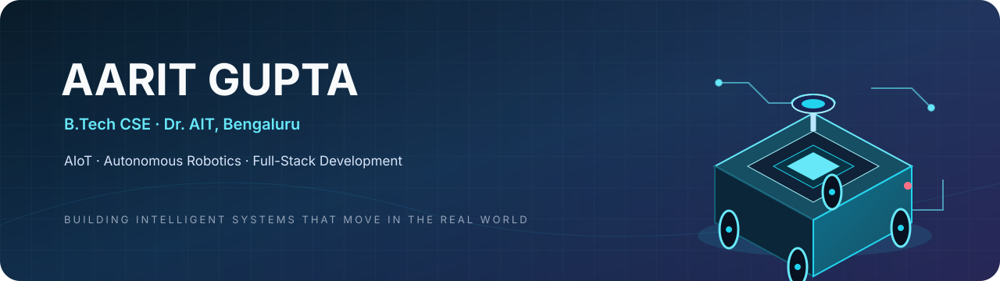
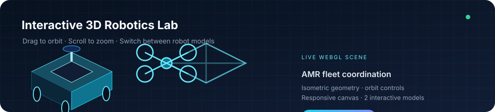
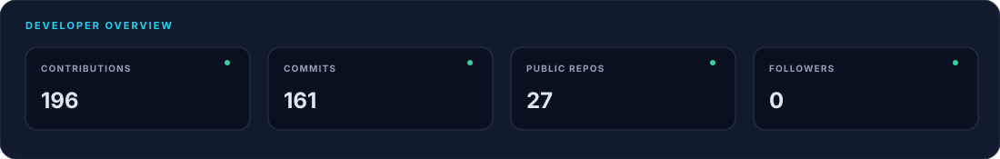
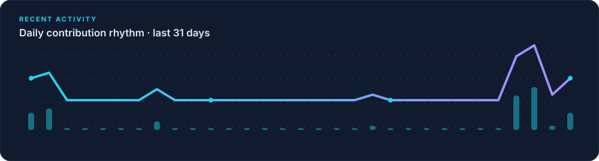

  
  
  

<table width="100%"><tr>
<td width="40%" valign="top"></td>
<td width="60%" valign="top">
<h2>Hi, I'm Aarit Gupta 👋</h2>

<b>B.Tech Computer Science & Engineering · Dr. Ambedkar Institute of Technology · Bengaluru</b>

I'm a CSE student who enjoys building practical software and intelligent systems. My work and interests span AI-powered applications, multi-agent systems, autonomous robots, connected devices, and full-stack development.

<h3>What I work on</h3>
<ul>
<li>🤖 Autonomous robotics, multi-robot coordination, ROS 2, and Gazebo</li>
<li>🧠 Applied ML, NLP, OCR, and AI-agent workflows</li>
<li>🌐 Full-stack applications, REST APIs, and data-backed products</li>
</ul>
<h3>Education</h3>
<ul>
<li><b>Dr. AIT, Bengaluru</b> · B.E. Computer Science & Engineering · 2023–2027</li>
<li><b>Narayana E-techno School</b> · Senior Secondary · 80%</li>
<li><b>DAV Public School</b> · High School · 91%</li>
</ul>

<b>Currently building:</b> AIoT · Autonomous Robotics · Full-Stack Systems

</td>
</tr></table>

<picture><source media="(prefers-color-scheme: dark)" srcset="assets/animated/about-meta-dark.svg"/><source media="(prefers-color-scheme: light)" srcset="assets/animated/about-meta-light.svg"/></picture>

<b><a href="https://aarit88.github.io/aarit88/showcase/">↗ Open the Interactive 3D Robotics Lab</a></b> · Drag to orbit, zoom, and switch between the AMR and quadcopter models.

---

<picture><source media="(prefers-color-scheme: dark)" srcset="assets/animated/developer-overview-dark.svg"/><source media="(prefers-color-scheme: light)" srcset="assets/animated/developer-overview-light.svg"/></picture>

  
  

<picture><source media="(prefers-color-scheme: dark)" srcset="assets/animated/activity-graph-dark.svg"/><source media="(prefers-color-scheme: light)" srcset="assets/animated/activity-graph-light.svg"/></picture>

<picture><source media="(prefers-color-scheme: dark)" srcset="assets/animated/annual-heatmap-dark.svg"/><source media="(prefers-color-scheme: light)" srcset="assets/animated/annual-heatmap-light.svg"/></picture>

---

<picture><source media="(prefers-color-scheme: dark)" srcset="assets/animated/project-showcase-dark.svg"/><source media="(prefers-color-scheme: light)" srcset="assets/animated/project-showcase-light.svg"/></picture>

| Project | What it explores | Repository |
| --- | --- | --- |
| **SwarmGrid** | Decentralized multi-robot warehouse AMR coordination with ROS 2, Gazebo, auction-based task allocation, A* path planning, and recovery workflows. | [Open repo](https://github.com/aarit88/swarmgrid) |
| **Shakti-Prana / Sakhi** | Women's health vault and wellness platform with health tracking, AI assistance, and clinical document processing. | [Open repo](https://github.com/aarit88/sakhi) |
| **LumiSmart-AI** | AIoT closed-loop supplemental lighting. | In progress |
| **Bio-Solar Swarm / BioPods** | Decentralized urban air remediation concept. | In progress |
| **OsteoGuard AI** | Deep learning for bone disorder diagnosis. | [Open repo](https://github.com/aarit88/osteophorosis) |
| **SWARMNET** | Multi-agent emergency response system with real-time telemetry, coordinated agents, and a tactical map dashboard. | [Open repo](https://github.com/aarit88/SWARMNET) |
| **BioPods · Infrastructure** | Agentic AI platform for Kubernetes monitoring, anomaly diagnosis, guarded remediation, and recovery verification. | [Open repo](https://github.com/aarit88/biopods) |

---

<picture><source media="(prefers-color-scheme: dark)" srcset="assets/animated/technical-toolkit-dark.svg"/><source media="(prefers-color-scheme: light)" srcset="assets/animated/technical-toolkit-light.svg"/></picture>

**Languages**  
     

**Web · APIs · Data**  
       

**Robotics · Hardware · Vision**  
        

**Also:** Dart · Flutter · Express · Prisma · Redis · Kubernetes · WebSockets · Git · Swagger · Jupyter Notebook

---

<picture><source media="(prefers-color-scheme: dark)" srcset="assets/animated/credentials-dark.svg"/><source media="(prefers-color-scheme: light)" srcset="assets/animated/credentials-light.svg"/></picture>

- **Qualcomm Academy:** AI Technical Foundation · Hands-on Development from Model to App
- **Hackathons participated:** Adobe Hackathon · AI for Bharat · ABB · SIH

---

<picture><source media="(prefers-color-scheme: dark)" srcset="https://raw.githubusercontent.com/aarit88/aarit88/output/github-contribution-grid-snake-dark.svg"/><source media="(prefers-color-scheme: light)" srcset="https://raw.githubusercontent.com/aarit88/aarit88/output/github-contribution-grid-snake.svg"/></picture>

---

Curious about intelligent systems that connect software to the physical world.

<a href="https://www.linkedin.com/in/aarit-gupta-18093130b/">LinkedIn</a> · <a href="mailto:aaritgupta11@gmail.com">Email</a> · <a href="https://github.com/aarit88">GitHub</a>

